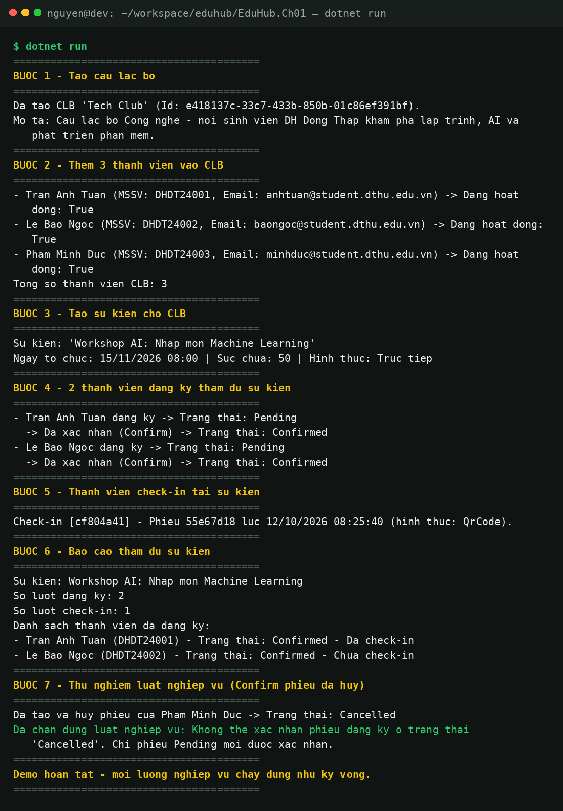

# EduHub - Bai tap Chuong 1: Phan tich yeu cau & Domain Modeling

He thong quan ly **Cau lac bo & Su kien sinh vien** Truong Dai hoc Dong Thap.
Bai tap thuoc mon **IN4211 - Phat trien phan mem huong doi tuong** (ThS. Nguyen Tuan Kiet).

## 1. Thiet ke domain

Domain gom **5 class chinh** (xem chi tiet tai `docs/class-diagram.md`):

| Class | Vai tro | Quan he |
|-------|---------|---------|
| `Member` | Thanh vien sinh vien cua CLB | 1 CLB co nhieu Member |
| `Club` | Cau lac bo sinh vien | 1 CLB to chuc nhieu Event |
| `Event` | Su kien do CLB to chuc | 1 Event nhan nhieu Registration |
| `Registration` | Phieu dang ky (bang noi nhieu-nhieu Member - Event) | 1 Registration co toi da 1 CheckIn |
| `CheckIn` | Ban ghi diem danh tai su kien | - |

Hai **enum** thay cho chuoi rai rac: `RegistrationStatus` (`Pending` / `Confirmed` / `Cancelled`)
va `CheckInMethod` (`Manual` / `QrCode`).

### Nguyen tac thiet ke ap dung

- **Encapsulation:** moi property dung `private set`, tap hop `Members` chi lo ra duoi dang `IReadOnlyList`; constructor `private`.
- **Factory method:** moi class tao moi qua `static Create(...)`, tap trung **validation** (ten trong, email thieu `@`, `Capacity <= 0`, ngay su kien trong qua khu, `Guid.Empty`...).
- **Behavior, khong chi du lieu:** `Club.AddMember()` (chan trung), `Club.MemberCount()`, `Event.HasCapacity()`, `Registration.Confirm()/Cancel()` (may trang thai), `CheckIn.Summary()`, `Member.IsActive()`.
- **Luat nghiep vu duoc ep bang exception:** `Confirm()` phieu da huy -> `InvalidOperationException`.
- **Nullable** duoc bat (`<Nullable>enable</Nullable>`), XML doc comment day du cho moi public API.

## 2. Cau truc thu muc

```text
EduHub.Ch01/
├── Domain/
│   ├── Member.cs
│   ├── Club.cs
│   ├── Event.cs
│   ├── Registration.cs
│   ├── CheckIn.cs
│   ├── RegistrationStatus.cs   (enum)
│   └── CheckInMethod.cs        (enum)
├── docs/
│   ├── user-stories.md         (6 user stories + acceptance criteria)
│   ├── class-diagram.md        (so do lop Mermaid + giai thich quan he)
│   └── screenshot-run.png      (anh chup ket qua chay)
├── Program.cs                  (console app demo)
├── EduHub.Ch01.csproj          (.NET 10, Nullable enable)
└── README.md
```

## 3. Cach chay app

Yeu cau: [.NET 10 SDK](https://dotnet.microsoft.com/download).

```bash
cd EduHub.Ch01
dotnet run
```

App demo chay day du luong nghiep vu theo 7 buoc:

1. Tao CLB **Tech Club**
2. Them 3 thanh vien
3. Tao su kien **Workshop AI** (capacity = 50)
4. 2 thanh vien dang ky -> `Pending` -> `Confirm()`
5. 1 thanh vien check-in bang QR
6. In bao cao tham du (so dang ky, so check-in, danh sach ten)
7. Thu `Confirm()` phieu da huy -> bat `InvalidOperationException` dung luat

## 4. Ket qua chay

Anh chup console khi chay `dotnet run`:


