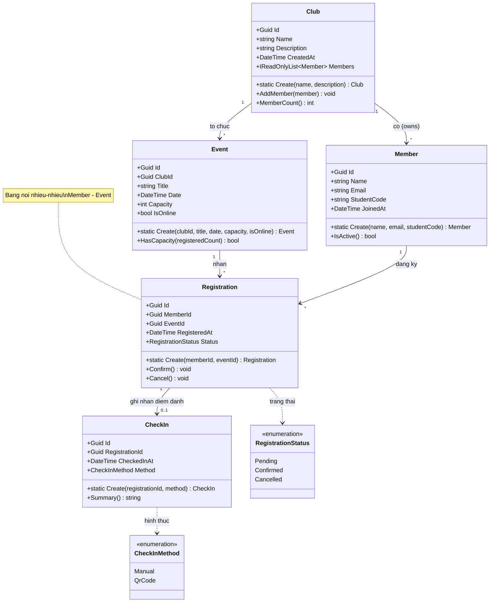

# So do lop so bo - EduHub (Chuong 1)

## Giai thich thiet ke

| Quan he | Boi so | Y nghia |
|---------|--------|---------|
| Club - Member | 1 - * | Mot CLB co nhieu thanh vien; trong pham vi Ch01, moi ban ghi `Member` gan voi 1 CLB quan ly (du cho luong demo) |
| Club - Event | 1 - * | Mot CLB to chuc nhieu su kien; moi su kien thuoc dung 1 CLB (`ClubId` - khoa ngoai) |
| Event - Registration | 1 - * | Mot su kien nhan nhieu phieu dang ky; moi phieu thuoc dung 1 su kien (`EventId`) |
| Member - Registration | 1 - * | Mot thanh vien dang ky nhieu su kien; moi phieu thuoc dung 1 thanh vien (`MemberId`) |
| Registration - CheckIn | 1 - 0..1 | Moi phieu dang ky duoc check-in toi da 1 lan (`RegistrationId`) |

- `Registration` la **bang noi** (association class) cho quan he nhieu-nhieu giua `Member` va `Event`, dong thoi mang trang thai nghiep vu (`Pending` / `Confirmed` / `Cancelled`).
- `RegistrationStatus` va `CheckInMethod` la **enum** - khong dung chuoi rai rac (tuan thu yeu cau "khong magic string").
- Tat ca class dung **factory method** `Create(...)` + constructor private; property `private set`/`init`; validation tap trung trong `Create(...)`.
